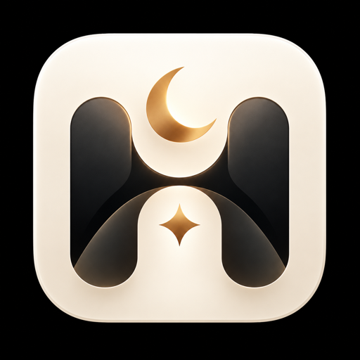

<div align="center">
  
  <h1>Harmonotch</h1>
  <p>A macOS menu bar and notch companion for prayer times, battery status, and media playback.</p>

[](https://apple.com/macos)
[](https://swift.org)
[](https://developer.apple.com/swiftui/)
[](https://harmonotch-web.vercel.app)
[](LICENSE)

</div>

Harmonotch turns the camera cutout on a MacBook into a small control surface. Hover the notch to open a drawer with four tabs: prayer times, battery status, media with synced lyrics, and AI agent quota telemetry. On a Mac without a notch, the same controls live in the menu bar.

Prayer times are calculated on device. The app has no account, no analytics, and no server for prayer or battery data. Lyrics and update checks use the network.

## Features

### Prayer times

- Six daily times (Fajr, Sunrise, Dhuhr, Asr, Maghrib, Isha) calculated locally with [Adhan-Swift](https://github.com/batoulapps/adhan-swift).
- Calculation methods: Kemenag, Muslim World League, ISNA, Umm Al-Qura, Egyptian General Authority, University of Islamic Sciences Karachi, Dubai, Qatar, Kuwait, Singapore, and Turkey.
- Manual minute offsets, an Imsak time, and a Hijri date in the drawer.
- Automatic adhan playback at each prayer, with mute, volume, test playback, and a stop button.
- Indonesian city presets, or optional location lookup through CoreLocation and MapKit.

### Battery

- Reads percentage, charging state, and power source from IOKit (`AppleSmartBattery`).
- Computes battery health aligned with macOS System Settings (`NominalChargeCapacity` / `AppleRawMaxCapacity` against `DesignCapacity`) alongside cycle count, temperature, and voltage.
- Shows time to full or time to empty, and the connected adapter wattage.
- **Hardware Charge Limiter (80% Cap / AC Bypass)**:
  - Caps charging at 80% (or custom 70% / 90% / 100%) to preserve battery chemistry and extend lifespan.
  - Controls hardware SMC registers (`CH0B` for Apple Silicon M1–M4 in bypass mode; `BCLM` for Intel Macs) across macOS versions (Tahoe / Golden Gate, Sequoia, Sonoma, and Ventura).
  - Smart hysteresis (2% buffer) prevents rapid charging on/off cycles when hovering at the threshold.
  - Automatic fail-safe: restores normal charging state when quitting the app or unplugging the power cable.
  - One-click privilege setup via `/etc/sudoers.d/harmonotch`, with fallbacks to CLI tools (`battery`, `smc`) and smart audio/visual notifications.
- **Clamshell Mode (Stay Awake with Lid Closed)**:
  - Keeps the Mac awake and the external monitor active as the primary display when the MacBook lid is closed.
  - **Requirements**: An external display must be connected; without an external display, the mode stays in `Standby (No Display)` and never disables system sleep.
  - **Battery & Power Adapter Policy**: Connecting a power adapter is recommended. When running on battery power, Harmonotch sends a warning notification at `60%` and automatically pauses Clamshell Mode at `≤ 50%`, restoring normal sleep (`SleepDisabled 0`) and putting the Mac to sleep if the lid is closed. Reconnecting the power adapter automatically resumes the session.
  - **Ownership & Crash Recovery**: Tracks override ownership (`Harmonotch_ClamshellOverrideOwned`) before enabling `disablesleep 1`, restores sleep synchronously on app termination, and recovers stale state on next launch without interfering with `disablesleep` set by other tools.
  - **Admin Permission & Manual Cleanup**: Uses a dedicated sudoers file at `/etc/sudoers.d/harmonotch-clamshell` scoped to your user UID for `/usr/bin/pmset -a disablesleep 1` and `0` only (separate from the Charge Limiter rule at `/etc/sudoers.d/harmonotch`). To remove and reset manually without the app:
    ```bash
    sudo rm -f /etc/sudoers.d/harmonotch-clamshell
    sudo /usr/bin/pmset -a disablesleep 0
    defaults delete com.ssajudn.Harmonotch Harmonotch_ClamshellOverrideOwned 2>/dev/null || true
    ```
- Shortcuts to refresh telemetry or open macOS Battery settings.

### Media and lyrics

- Playback monitoring and transport control (`play/pause`, `next`, `previous`, `seek`) for Apple Music, Spotify, QuickTime, Podcasts, and browsers through a MediaRemote bridge: a small adapter loaded into Apple's `/usr/bin/perl` because macOS no longer answers MediaRemote directly from third-party apps. The technique was inspired by [Vorssaint](https://github.com/vorssaint/vorssaint-utils), licensed GPL-3.0-or-later, and is used with the author's written permission. Harmonotch's adapter is an independent implementation and contains no Vorssaint source code. When the bridge is unavailable, the app falls back to AppleScript and Safari/Chromium Apple Events.
- Collapsed notch narrows toward the hardware notch while playing, showing the interactive companion and artwork thumbnail on the expanded left wing with a live equalizer waveform on the right, then restores the battery layout when playback ends.
- Expanded 560pt notch drawer displays high-resolution 64×64 artwork, track metadata, interactive progress scrubber, playback transport controls, and time-synchronized karaoke lyrics from [LRCLIB](https://lrclib.net/).
- Lets you click any lyric line to seek directly to its timestamp.

The MediaRemote bridge uses an undocumented Apple framework, so it can change or disappear in a future macOS release. That is why the AppleScript path stays in place, and why this app ships outside the Mac App Store.

### Volume HUD in Notch (Single-Owner)

- Clean volume indicator seamlessly rendered in the notch when volume keys (up, down, mute) are pressed.
- **Strict Single Ownership Architecture**: Per keypress, only one HUD owns the screen. When Harmonotch handles volume, the native macOS OSD is intercepted without showing dual/duplicate HUDs.
- **Hardware Fallback**: Directly writes to CoreAudio (`AudioObjectSetPropertyData`). If the active device does not support software volume or write fails, control immediately falls back to native macOS with an automatic grace period.
- **Native Feedback Parity**: Honors macOS "Play feedback when volume is changed" setting and Shift key inversion using Apple's official `volume.aiff` audio sample.
- **Third-Party App Note**: Harmonotch uses a `.cgSessionEventTap` to intercept volume keys. Do not run Harmonotch simultaneously with other utilities that consume volume keys (e.g. Vorssaint, BetterDisplay, or MonitorControl), as multiple competing event taps cannot coordinate key consumption.

### AI agent quota telemetry

- Live tracking of quota remaining and reset countdowns across active coding agents: **Google Antigravity**, **Claude Code**, **Ollama**, **Cursor**, and **GitHub Copilot**.
- Non-interactive local CLI evaluation (e.g. `agy -p "/usage"`), querying authorized quotas without storing API keys, passwords, or personal credentials (100% passive & ban-safe).
- In-memory 30-second cache prevents excessive subshell calls and eliminates CPU overhead.
- Dynamic notch drawer height: the drawer dynamically expands (between ~180pt and ~350pt) to fit discovered model tiers, and provides smooth vertical scrolling when more than 5 models are present.
- Built-in Antigravity onboarding guide: if `agy` is not installed or logged in, a clean onboarding card provides 3-step setup guidance, a direct link to documentation (`https://antigravity.google`), and a one-click copy button for `agy`.

### Interface

- Pure monochrome black-and-white (`#000000` / `#FFFFFF`) aesthetic engineered to blend invisibly into the physical MacBook camera housing.
- Interactive battery-aware notch companion (`PrayerCompanionView`) that appears on left-wing hover or active playback/adhan states with expressive mood animations.
- Fluid spring shrink/expand geometry (`NotchMotion`) with selective cursor hit-testing so the macOS menu bar only activates outside the notch radius.
- English and Indonesian, switched from the menu bar without a restart.
- Streamlined monochrome menu bar panel with the next prayer, battery telemetry, language switcher, clamshell mode, and update checks.
- Notch drawer with keyboard shortcuts for tabs, adhan mute, and hiding the overlay.

## Requirements

- macOS 14.0 (Sonoma) or later. Verified up to macOS 27.
- Xcode 16.3 or later (Swift 6.1+, needed for `nonisolated` types).

## Build and run

```bash
git clone https://github.com/Udean777/Harmonotch.git
cd Harmonotch
open Harmonotch.xcodeproj
```

Press `Cmd + R` in Xcode. For a release build from the command line:

```bash
xcodebuild -project Harmonotch.xcodeproj -scheme Harmonotch -configuration Release -destination 'platform=macOS' build
```

## Release signing

The release workflow signs with a stable certificate when these secrets are set:

| Secret | Value |
| --- | --- |
| `SIGNING_CERT_P12` | base64 of the `.p12` (single line) |
| `SIGNING_CERT_PASSWORD` | password used when exporting the `.p12` |

Without them the workflow falls back to ad-hoc signing. Do not ship that way: an ad-hoc signature makes every TCC grant (microphone, Automation, Input Monitoring) cdhash-based, so each update resets them until the app is removed and re-added in System Settings.

To create a free self-signed certificate:

1. Keychain Access → Certificate Assistant → Create a Certificate…
   Name `Harmonotch Release`, Identity Type *Self Signed Root*, Certificate Type *Code Signing*.
2. Export it as `.p12` with a password, then run `base64 -i HarmonotchRelease.p12 | pbcopy` and paste it into `SIGNING_CERT_P12`.

After a release, verify the identity is stable:

```bash
codesign -d -r- /Applications/Harmonotch.app
# expect: identifier "com.ssajudn.Harmonotch" and certificate leaf = H"..."
# not:    cdhash H"..."
```

Users upgrading from an ad-hoc build must remove and re-add the app in System Settings → Privacy & Security once.

## Test

```bash
./Tests/run-tests.sh
```

The harness compiles the pure logic and checks prayer times, version comparison, the LRC parser, compass headings, and the clamshell policy.

## Project structure

```text
Harmonotch/
├── App/
│   ├── AppDelegate.swift             // AppKit lifecycle and menu bar item
│   └── UserDefaultsKeys.swift        // Centralized UserDefaults keys
├── HarmonotchApp.swift               // App entry point
├── NotchUI/
│   ├── NotchGeometryHelper.swift     // Notch geometry detection
│   ├── NotchWindowController.swift   // Floating panel with selective hit testing
│   ├── NotchViewModel.swift          // Hover and dismiss state
│   ├── NotchContainerView.swift      // Drawer and tab container
│   ├── NotchTab.swift                // Tab enum and segmented control
│   ├── NotchChip.swift               // Shared chip and motion tokens
│   ├── NotchPillView.swift           // Collapsed notch content
│   └── PureBlackSurface.swift        // Pure solid black notch silhouette
├── Features/
│   ├── MenuBar/                      // Monochrome menu bar panel
│   ├── Theme/                        // Monochrome and palette color tokens
│   ├── Localization/                 // Language state and strings
│   ├── Prayer/                       // Prayer engine, adhan audio, companion, city presets
│   ├── Battery/                      // IOKit monitor and clamshell mode
│   ├── AI/                           // Multi-provider AI agent quota monitoring and telemetry
│   │   ├── AIModelQuota.swift        // Model quota and countdown data models
│   │   ├── AIUsageDrawerView.swift   // Dynamic scrollable notch drawer card & CLI onboarding
│   │   ├── AIUsageManager.swift      // Multi-provider telemetry coordinator
│   │   ├── AntigravityProcessDetector.swift // Safe local process and socket scanner
│   │   ├── AntigravityQuotaService.swift    // Antigravity CLI `/usage` integration
│   │   ├── ClaudeCodeQuotaService.swift
│   │   ├── CopilotQuotaService.swift
│   │   ├── CursorQuotaService.swift
│   │   └── OllamaQuotaService.swift
│   ├── KeyboardBacklight/            // Built-in keyboard light level
│   ├── Media/                        // MediaRemote bridge, lyrics, and metadata
│   ├── Update/                       // GitHub release checks
│   └── About/                        // About window and credits
├── web/                              // Landing page (HTML, CSS, JS)
├── Assets.xcassets/
├── Resources/
│   ├── adzan.m4a
│   └── adzan_subuh.m4a
└── Tests/
```

## Credits

- [Adhan-Swift](https://github.com/batoulapps/adhan-swift) by Batoul Apps (MIT License) for astronomical prayer calculations.
- [LRCLIB](https://lrclib.net/) for synced lyrics.
- [IslamDownload.net](https://islamdownload.net/123801-download-suara-adzan.html) for the adhan recordings.
- [Vorssaint](https://github.com/vorssaint/vorssaint-utils) (GPL-3.0-or-later) for the MediaRemote-through-Perl technique, for research into demand-driven monitoring and modular utility panels, and for the clamshell and volume-key-HUD behavior that informed Harmonotch's implementations. Harmonotch's implementations are written independently from Apple documentation, original testing, and observed runtime behavior; no Vorssaint source code, assets, strings, type names, or trade dress are included. Harmonotch is not affiliated with or endorsed by Vorssaint.
- Apple for the iTunes Search API, `MediaRemote`, SF Symbols, and IOKit.

Full license texts and attributions are in [ACKNOWLEDGEMENTS.md](ACKNOWLEDGEMENTS.md). Engineering provenance and clean-room boundaries are documented in [docs/IMPLEMENTATION_PROVENANCE.md](docs/IMPLEMENTATION_PROVENANCE.md).

## License

MIT. See [LICENSE](LICENSE).
