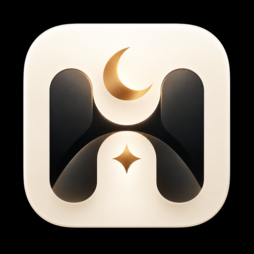

<div align="center">
  
  <h1>Harmonotch</h1>
  <p>A macOS menu bar and notch companion for prayer times, battery status, and media playback.</p>

[](https://apple.com/macos)
[](https://swift.org)
[](https://developer.apple.com/swiftui/)
[](https://harmonotch-web.vercel.app)
[](LICENSE)

</div>

Harmonotch turns the camera cutout on a MacBook into a small control surface. Hover the notch to open a drawer with three tabs: prayer times, battery status, and media with synced lyrics. On a Mac without a notch, the same controls live in the menu bar.

Prayer times are calculated on device. The app has no account, no analytics, and no server for prayer or battery data. Lyrics and update checks use the network.

## Features

### Prayer times

- Six daily times (Fajr, Sunrise, Dhuhr, Asr, Maghrib, Isha) calculated locally with [Adhan-Swift](https://github.com/batoulapps/adhan-swift).
- Calculation methods: Kemenag, Muslim World League, ISNA, Umm Al-Qura, Egyptian General Authority, University of Islamic Sciences Karachi, Dubai, Qatar, Kuwait, Singapore, and Turkey.
- Manual minute offsets, an Imsak time, and a Hijri date in the drawer.
- Automatic adhan playback at each prayer, with mute, volume, test playback, and a stop button.
- Indonesian city presets, or optional location lookup through CoreLocation and MapKit.

### Battery

- Reads percentage, charging state, and power source from IOKit (`AppleSmartBattery`).
- Computes battery health aligned with macOS System Settings (`NominalChargeCapacity` / `AppleRawMaxCapacity` against `DesignCapacity`) alongside cycle count, temperature, and voltage.
- Shows time to full or time to empty, and the connected adapter wattage.
- Includes Clamshell Awake policy control and shortcuts to refresh telemetry or open macOS Battery settings.

### Media and lyrics

- Real-time system-wide playback monitoring and transport control (`play/pause`, `next`, `previous`, `seek`) across Safari, WebKit, Chrome, YouTube, YouTube Music, Spotify, and Apple Music via macOS `MediaRemote` and the NowPlaying architecture from [vorssaint-utils](https://github.com/vorssaint/vorssaint-utils), with AppleScript and iTunes Search API metadata fallbacks.
- Collapsed notch narrows toward the hardware notch while playing, showing the interactive companion and artwork thumbnail on the expanded left wing with a live equalizer waveform on the right, then restores the battery layout when playback ends.
- Expanded 560pt notch drawer displays high-resolution 64×64 artwork, track metadata, interactive progress scrubber, playback transport controls, and time-synchronized karaoke lyrics from [LRCLIB](https://lrclib.net/).
- Lets you click any lyric line to seek directly to its timestamp.

### Interface

- Pure monochrome black-and-white (`#000000` / `#FFFFFF`) aesthetic engineered to blend invisibly into the physical MacBook camera housing.
- Interactive battery-aware notch companion (`PrayerCompanionView`) that appears on left-wing hover or active playback/adhan states with expressive mood animations.
- Fluid spring shrink/expand geometry (`NotchMotion`) with selective cursor hit-testing so the macOS menu bar only activates outside the notch radius.
- English and Indonesian, switched from the menu bar without a restart.
- Streamlined monochrome menu bar panel with the next prayer, battery telemetry, language switcher, clamshell mode, and update checks.
- Notch drawer with keyboard shortcuts for tabs, adhan mute, and hiding the overlay.

## Requirements

- macOS 14.0 (Sonoma) or later.
- Xcode 16.0 or later with the Swift 6 toolchain.

## Build and run

```bash
git clone https://github.com/Udean777/Harmonotch.git
cd Harmonotch
open Harmonotch.xcodeproj
```

Press `Cmd + R` in Xcode. For a release build from the command line:

```bash
xcodebuild -project Harmonotch.xcodeproj -scheme Harmonotch -configuration Release -destination 'platform=macOS' build
```

## Test

```bash
./Tests/run-tests.sh
```

The harness compiles the pure logic and checks prayer times, version comparison, the LRC parser, compass headings, and the clamshell policy.

## Project structure

```text
Harmonotch/
├── App/
│   ├── AppDelegate.swift             // AppKit lifecycle and menu bar item
│   └── UserDefaultsKeys.swift        // Centralized UserDefaults keys
├── HarmonotchApp.swift               // App entry point
├── NotchUI/
│   ├── NotchGeometryHelper.swift     // Notch geometry detection
│   ├── NotchWindowController.swift   // Floating panel with selective hit testing
│   ├── NotchViewModel.swift          // Hover and dismiss state
│   ├── NotchContainerView.swift      // Drawer and tab container
│   ├── NotchTab.swift                // Tab enum and segmented control
│   ├── NotchChip.swift               // Shared chip and motion tokens
│   ├── NotchPillView.swift           // Collapsed notch content
│   └── PureBlackSurface.swift        // Pure solid black notch silhouette
├── Features/
│   ├── MenuBar/                      // Monochrome menu bar panel
│   ├── Theme/                        // Monochrome and palette color tokens
│   ├── Localization/                 // Language state and strings
│   ├── Prayer/                       // Prayer engine, adhan audio, companion, city presets
│   ├── Battery/                      // IOKit monitor and clamshell mode
│   ├── Media/                        // MediaRemote, NowPlaying, lyrics, and metadata
│   ├── Update/                       // GitHub release checks
│   └── About/                        // About window and credits
├── web/                              // Landing page (HTML, CSS, JS)
├── Assets.xcassets/
├── Resources/
│   ├── adzan.m4a
│   └── adzan_subuh.m4a
└── Tests/
```

## Credits

- [Adhan-Swift](https://github.com/batoulapps/adhan-swift) by Batoul Apps (MIT License) for astronomical prayer calculations.
- [vorssaint-utils](https://github.com/vorssaint/vorssaint-utils) by Vorssaint for the macOS `NowPlayingAdapter` / `MediaRemote` real-time media playback architecture and reference implementation.
- [LRCLIB](https://lrclib.net/) for synced lyrics.
- [IslamDownload.net](https://islamdownload.net/123801-download-suara-adzan.html) for the adhan recordings.
- Apple for the iTunes Search API, `MediaRemote`, SF Symbols, and IOKit.

Full license texts and attributions are in [ACKNOWLEDGEMENTS.md](ACKNOWLEDGEMENTS.md).

## License

MIT. See [LICENSE](LICENSE).
